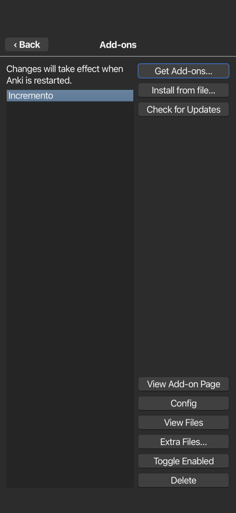
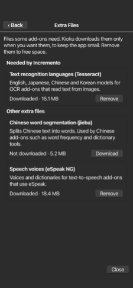

# Screenshots

Every screenshot of the phone variants, the web version and the Docker
image. The native ones were taken with
`shared/tools/readme_shots.sh` (profile with the NeetCode and HSK 1
Recognition decks); the README strips are built from them by
`shared/tools/make_readme_strips.py`.

## iPhone and iPad

iPhone 15 Pro Max, iOS 26.

| Deck list | Reviewing: question | Reviewing: answer |
| :---: | :---: | :---: |
|  |  |  |

| Reviewing a NeetCode card | Browse | Statistics |
| :---: | :---: | :---: |
|  |  |  |

| Add |
| :---: |
|  |

| Add-ons with Extra Files | Extra Files |
| :---: | :---: |
|  |  |

## Android, native variant

Emulator, Android 17. Every Anki window opens full screen; popups are cards
above the keyboard.

| Deck list | Reviewing: question | Reviewing: answer |
| :---: | :---: | :---: |
|  |  |  |

| Reviewing a NeetCode card | Browse | Statistics |
| :---: | :---: | :---: |
|  |  |  |

| Add |
| :---: |
|  |

## Android, Termux variant

Samsung M30s, Android 11. Anki runs in a small Linux desktop with a dock.

| Desktop | Deck list | Reviewing |
| :---: | :---: | :---: |
|  |  |  |

| Software | Settings |
| :---: | :---: |
|  |  |

## Web

Chrome on a computer.

| Deck list | Add |
| :---: | :---: |
|  |  |

| Reviewing | Import |
| :---: | :---: |
|  |  |

## Self-hosted server (Docker)

Anki desktop on the server, in Chrome (taken by `desktop/test/run.sh`).

| Phone, `ANKI_FIT_SCREEN` | Browse on a phone |
| :---: | :---: |
|  |  |
